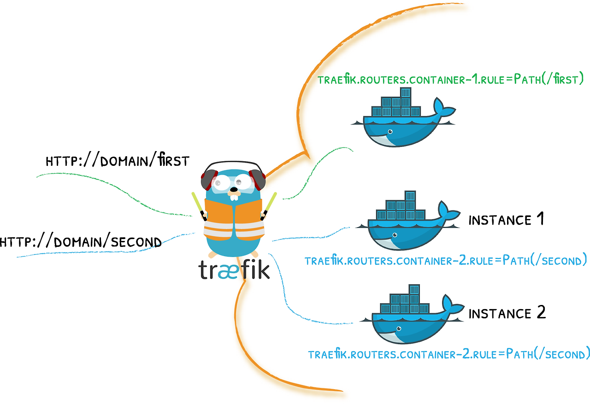
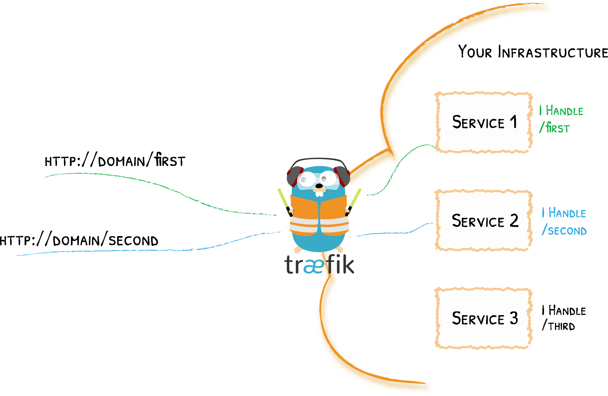

> **요약** · Traefik은 들어오는 요청을 호스트명이나 경로에 따라 백엔드로 전달하는 리버스 프록시다. Docker Provider는 컨테이너 라벨을 읽어 라우팅 설정을 갱신한다. 먼저 로컬에서 경로 라우팅을 확인한 뒤, 공개 도메인이 있다면 HTTPS를 추가할 수 있다.

## Traefik은 어디에 놓이나



그림에서는 브라우저가 같은 도메인으로 요청해도 `/first`와 `/second`가 각기 다른 서비스로 전달된다. `/second` 서비스는 두 인스턴스에 요청을 분산할 수 있다. 그림은 개념을 설명하고, 실제 라벨 문법은 아래 Traefik v3 예제를 따른다. [그림이 실린 참고 글](https://breeze-winter.tistory.com/20)

| 구성 요소 | 하는 일 | 이 글의 예시 |
| --- | --- | --- |
| EntryPoint | 요청을 받는 네트워크 진입점을 연다. | `web`은 컨테이너의 `80` 포트에서 HTTP 요청을 받는다. |
| Router | 요청이 규칙에 맞으면 연결된 서비스로 전달한다. | `whoami.localhost`와 `/demo` 경로를 확인한다. |
| Middleware | 서비스로 전달하기 전 요청이나 응답을 처리한다. | `StripPrefix`가 `/demo`를 제거한다. |
| Service | 요청을 전달할 백엔드 주소와 포트를 지정한다. | Docker 네트워크 안의 `whoami:80`으로 전달한다. |

## Docker 라벨로 서비스를 찾는 방식



Traefik이 시작할 때 EntryPoint와 Docker Provider를 설정한다. Docker Provider는 Docker API를 통해 컨테이너와 라벨을 확인하고, 컨테이너가 추가되거나 중지되면 동적 라우팅 설정을 갱신한다. Compose 파일의 라벨을 바꾼 경우 해당 서비스에 `docker compose up -d`를 다시 실행하면 변경된 라벨이 반영된다. 아래 예제에서는 `traefik.enable=true`를 지정한 서비스만 라우팅 대상으로 삼는다. [그림 원본 및 개념 설명](https://doc.traefik.io/traefik/v2.11/getting-started/concepts/#auto-service-discovery) · [Docker Provider 문서](https://doc.traefik.io/traefik/reference/install-configuration/providers/docker/)

## Docker Compose로 경로 라우팅 확인하기

빈 디렉터리에 아래 내용을 `compose.yaml`로 저장한다. Traefik만 호스트의 루프백 주소에 포트를 열고, 두 컨테이너는 Compose 기본 네트워크로 통신한다.

```yaml
services:
  traefik:
    image: traefik:v3.7
    command:
      - --entrypoints.web.address=:80
      - --providers.docker=true
      - --providers.docker.exposedbydefault=false
    ports:
      - "127.0.0.1:18080:80"
    volumes:
      - /var/run/docker.sock:/var/run/docker.sock:ro

  whoami:
    image: traefik/whoami:v1.11.0
    labels:
      traefik.enable: "true"
      traefik.http.routers.whoami.rule: "Host(`whoami.localhost`) && (Path(`/demo`) || PathPrefix(`/demo/`))"
      traefik.http.routers.whoami.entrypoints: web
      traefik.http.routers.whoami.service: whoami
      traefik.http.routers.whoami.middlewares: strip-demo
      traefik.http.middlewares.strip-demo.stripprefix.prefixes: /demo
      traefik.http.services.whoami.loadbalancer.server.port: "80"
```

`Path`와 `PathPrefix`를 함께 사용하면 `/demo`와 그 하위 경로를 받으면서 `/demolition`처럼 철자만 비슷한 경로는 제외할 수 있다. `/demo/check`로 요청하면 미들웨어가 접두사를 제거해 백엔드에는 `/check`로 전달한다. 서비스의 포트는 컨테이너 내부 포트다. [Docker 라우팅 예제](https://doc.traefik.io/traefik/expose/docker/basic/)

```bash
docker compose config --quiet
docker compose up -d
curl -fsS -H 'Host: whoami.localhost' http://127.0.0.1:18080/demo/check
```

응답에서 `GET /check HTTP/1.1`이 보이면 라우팅과 미들웨어가 동작한 것이다. 다음으로 서비스를 중지하고 라우팅이 제거되는지 확인한다. Docker 이벤트가 반영된 뒤에는 상태 코드 `404`가 나온다.

```bash
docker compose stop whoami
curl -sS -o /dev/null -w '%{http_code}\n' \
  -H 'Host: whoami.localhost' http://127.0.0.1:18080/demo/check
docker compose down
```

Docker 소켓은 읽기 전용으로 마운트해도 그 소켓을 통한 Docker API 호출 권한은 남는다. 운영에서는 Docker API 접근을 필요한 범위로 제한한다. [Traefik Docker API 접근 문서](https://doc.traefik.io/traefik/reference/install-configuration/providers/docker/#docker-api-access)

## 공개 도메인에 HTTPS 붙이기

Let's Encrypt HTTP-01을 사용하려면 DNS가 Traefik이 실행되는 호스트를 가리키고 외부에서 TCP 80과 443 포트에 접근할 수 있어야 한다. 로컬 예제의 포트 매핑을 `"80:80"`, `"443:443"`으로 바꾸고, Traefik의 `command`에 아래 항목을 추가한다. `admin@example.com`은 인증서 발급에 사용할 연락처로 바꾼다. [Traefik ACME HTTP-01 문서](https://doc.traefik.io/traefik/v3.6/reference/install-configuration/tls/certificate-resolvers/acme/#httpchallenge)

```yaml
- --entrypoints.websecure.address=:443
- --entrypoints.web.http.redirections.entrypoint.to=websecure
- --entrypoints.web.http.redirections.entrypoint.scheme=https
- --certificatesresolvers.letsencrypt.acme.email=admin@example.com
- --certificatesresolvers.letsencrypt.acme.storage=/letsencrypt/acme.json
- --certificatesresolvers.letsencrypt.acme.httpchallenge.entrypoint=web
```

Traefik 컨테이너에 `./letsencrypt:/letsencrypt`를 쓰기 가능한 볼륨으로 추가해 인증서 상태를 보존한다. 파일을 미리 만들 때는 `mkdir -p letsencrypt && touch letsencrypt/acme.json && chmod 600 letsencrypt/acme.json`을 실행한다. 서비스 라벨에서는 `whoami.localhost`를 운영할 공개 도메인으로 바꾸고 `traefik.http.routers.whoami.entrypoints`를 `websecure`로 지정한다. 마지막으로 `traefik.http.routers.whoami.tls.certresolver: letsencrypt` 라벨을 추가한다. [Traefik 인증서 저장 설정](https://doc.traefik.io/traefik/v3.6/reference/install-configuration/tls/certificate-resolvers/acme/#storage)

다시 배포한 뒤 `http://<공개 도메인>/demo/check`에서 HTTPS로 이동하는지 확인한다. 이어서 HTTPS 주소에서 신뢰할 수 있는 인증서가 제시되고 백엔드 응답을 받는지 확인한다.

이미지 출처 · [겨울바람, 「Traefik 이란?」](https://breeze-winter.tistory.com/20) · [Traefik 공식 개념 문서](https://doc.traefik.io/traefik/v2.11/getting-started/concepts/) · [공식 문서 MIT 고지](/blog/licenses/traefik-docs-mit.txt)
